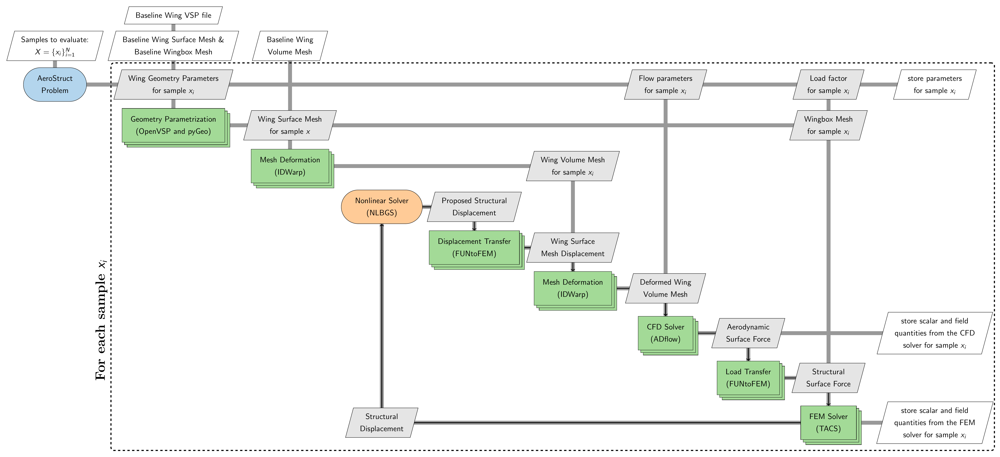

===================
Aerostruct Problem
===================

The ``Aerostruct`` problem provides an interface for generating static aerostructural wing datasets using a coupled high-fidelity analysis. Specifically, this problem couples a computational fluid dynamics (CFD) solver with a finite element (FE) solver to perform static aerostructural analysis. The ``Aerostruct`` problem currently uses ADflow_ as the CFD solver, TACS_ as the FE solver, and OpenVSP for wing shape parameteriation. Users can parameterize wing planform parameters, wing airfoil cross-section, operating conditions, and evaluate the resulting configurations without manually setting up the geometry paramerization, coupled analysis, and post-processing workflow. Additional CFD solvers, such as OpenFOAM and SU2, may be supported in future releases. The following sections describe the dependencies, computational workflow, and how to generate aerostructural datasets with the ``Aerostruct`` problem.

Dependencies
=============

The ``Aerostruct`` problem requires several additional packages that must be installed before using this problem. The required packages and their corresponding versions are listed below.

.. list-table::
   :header-rows: 1
   :widths: auto

   * - Package
     - Version
     - Comments
   * - `mpi4py`_
     - 3.1.6
     - Used for parallel processing during mesh deformation, CFD, and FE solver execution
   * - `mdolab-baseclasses`_
     - >= 1.8.4
     - Provides ``AeroProblem`` for defining flow conditions
   * - `openvsp`_
     - `-`
     - Handles wing shape paramerization
   * - `pygeo`_
     - >= 1.17.0
     - Provides an interface for handling wing shape parameterization through OpenVSP
   * - `idwarp`_
     - >= 2.6.2
     - Used for morphing volume mesh based on given shape parameters and during coupled analysis
   * - `adflow`_
     - 2.11.0
     - Used as the CFD solver for aerodynamic simulations
   * - `tacs`_
     - 3.7.2
     - Used as the FE solver for structural simulations
   * - `funtofem`_
     - 0.3.7
     - Used for transfering loads and displacement between CFD/FE solvers
   * - `mphys`_
     - 1.3.0
     - Used for setting up coupled aerostructural analysis with CFD and FE solver
   * - `pyvista`_
     - `-`
     - Used for reading, processing, and writing surface and volume field data
   * - `h5py`_
     - `-`
     - Used for creating and storing field results in HDF5 format

.. _mpi4py: https://mpi4py.readthedocs.io/en/3.1.6/
.. _mdolab-baseclasses: https://github.com/mdolab/baseclasses
.. _openvsp: https://github.com/OpenVSP/OpenVSP/tree/main/src/python_api/packages#openvsp-python-packages
.. _pygeo: https://github.com/mdolab/pygeo
.. _idwarp: https://github.com/mdolab/idwarp
.. _ADflow: https://github.com/mdolab/adflow
.. _TACS: https://github.com/smdogroup/tacs
.. _pyvista: https://docs.pyvista.org/
.. _h5py: https://docs.h5py.org/
.. _funtofem: https://github.com/smdogroup/funtofem
.. _mphys: https://github.com/openMDAO/MPHYS

Make sure that all required packages are installed with compatible versions before using the ``Aerostruct`` problem.

Workflow
=========

The ``Aerostruct`` problem accepts a set of samples, where each sample contains parameter values. This set may contain a single sample or multiple samples. For each sample :math:`x_i` in the sample set, the ``Aerostruct`` problem performs the sequence of operations described below:

1. **Wing shape parameterization**: Geometry parameters are used to define the wing planform shape and airfoil cross-section through ``OpenVSP`` and ``pyGeo``. Based on the geometry parameters, baseline CFD surface mesh coordinates and baseline wingbox FE mesh are deformed.
2. **Volume Mesh deformation**: The baseline CFD volume mesh is deformed based on the updated surface mesh coordinates using ``idwarp``.
3. **Coupled analysis**: A coupled analysis is then performed using the updated CFD volume mesh and the wingbox FE mesh, along with flow parameters and load factor.
4. **Output extraction**: Scalar and field quantities from the converged solver results are extracted and stored in a folder.

When multiple samples are provided, the workflow is evaluated for each sample, and the resulting outputs are stored separately for each sample. This allows the ``Aerostruct`` problem to provide a consistent interface for generating datasets without requiring users to manually manage geometry processing, mesh deformation, coupled solver execution, or output handling.

The complete workflow is illustrated in the XDSM diagram below.

The stacked rectangles representing various blocks such as shape paramerization, volume mesh deformation, CFD, and FE analysis indicate that these operations use multiple processors through MPI. The ``Aerostruct`` problem therefore abstracts geometry processing, mesh deformation, coupled-solver execution, and output handling required for each sample.

Basic usage
============

The files used in the example demonstrated below is available in the ``examples/wing_adflow_vsp`` directory.

Options
========

Following is the exhaustive list of options that can be set by the user for the ``AeroStruct`` problem:

.. pydantic-options:: blackbox.aerostruct_problem.WingAeroStructOptions
