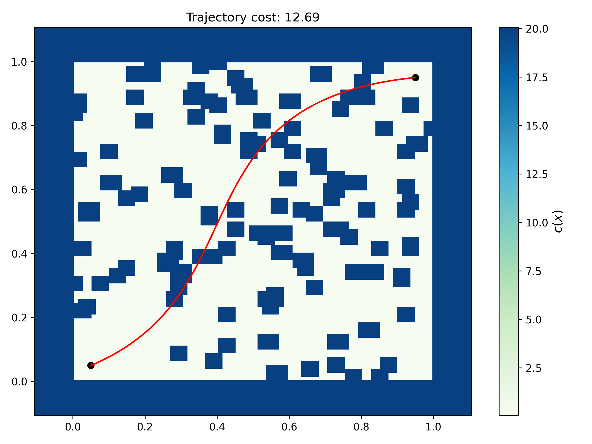

==========================
Rover Trajectory Problem
==========================

The rover trajectory problem is introduced in `Batched Large-scale Bayesian Optimization in High-dimensional Spaces <https://arxiv.org/abs/1706.01445>`_ as a high-dimensional blackbox optimization benchmark problem. In this problem, a rover must move through a 2D domain while avoiding obstacles and reaching a target location with a low-cost trajectory. The objective is not to optimize a closed-form function but to evaluate a trajectory defined by a set of control points. The trajectory is parameterized by a smooth B-spline and the cost of the path is computed by integrating pointwise penalties over the path. Even though the ``Rover`` problem is posed as a blackbox optimization problem, it can be treated as general purpose blackbox problem.

Usage
======

The following example demonstrates how to use the ``Rover`` problem class implemented in blackbox. Specifically, the ``Rover`` problem class is initialized, a Latin hypercube sampling plan is created, and is evaluated using the initialized problem class. Lastly, trajectory associated with one of the samples is also plotted.

.. literalinclude:: ../../../examples/rover_problem.py
    :start-after: # rst start
    :end-before: # rst end

The interface is straight-forward to use. The main class is ``Rover``, imported from ``blackbox.rover_trajectory_problem``. Once this class is initialized, it can be called to evaluate various trajectories defined by the control points.

1. Initialize the problem: ``problem = Rover(dim=dim, force_start=force_start, force_goal=force_goal)``

   The ``dim`` argument controls the dimension of the search space. In this implementation, the rover trajectory is defined by a set of B-spline control points, and the total problem dimension determines how many control points are used. If you set ``dim`` as 60, then there will be 30 (x,y) pairs that define the control points in the 2D space. The ``force_start`` and ``force_goal`` flags keep the trajectory anchored at the start and goal locations when set to ``True``. There are other arguments that can be used during initialization, refer to the API :doc:`documentation <../api/rover_traj_problem>`.

2. Generate a sampling plan:

   The example uses a Latin hypercube sample: ``x = lhs(problem.dim, 10, criterion="cm", random_state=10)``

   Followed by scaling into the problem domain: ``x = problem.lb + (problem.ub - problem.lb) * x``

   This creates a sampling plan of 10 designs, each of dimension ``problem.dim``. In other words, each row of ``x`` is one trajectory parameterization.

3. Evaluate samples: ``y = problem(x)``

   The initialized ``Rover`` object (problem in this case) accepts either a numpy array of shape ``(dim,)`` or a 2D array of shape ``(n_samples, dim)``.
   The returned value is the trajectory cost associated with each sample. When a single design is passed, the result is a 1D array-like scalar output; when several designs are passed together, one output is computed per sample.

4. Plot a trajectory: ``plot_traj(control_points=x[0], rover=problem, show_figure=False)``

   The ``plot_traj`` helper function plots the path over the obstacle field for a given set of control points. The function also displays the obstacle cost map, the start and goal positions, refer to API :doc:`documentation <../api/rover_traj_problem>` for more details about the function. The figure below shows the output from the ``plot_traj`` function. The red curve is the evaluated path, the background colormap is the environment cost, and the black markers indicate the start and goal positions.

