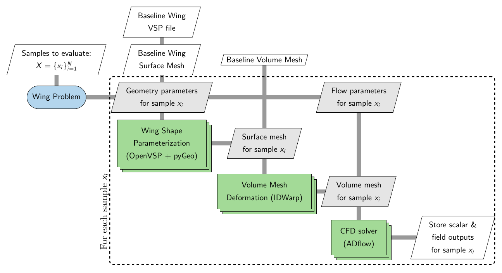

=================
Wing Problem
=================

The ``Wing`` problem provides an interface for generating aerodynamic datasets for wings using high-fidelity computational fluid dynamics (CFD) workflow. Users can parameterize wing planform parameters, wing airfoil cross-section, flow conditions, and evaluate the resulting configurations without manually setting up the geometry, meshing, solver, and post-processing workflow. The ``Wing`` problem currently uses ADflow_ as the CFD solver and the OpenVSP for wing shape parameteriation. Additional CFD solvers, such as OpenFOAM and SU2, may be supported in future releases. The following sections describe the dependencies, computational workflow, and how to generate aerodynamic datasets with the ``Wing`` problem.

Dependencies
=============

The ``Wing`` problem requires several additional packages that must be installed before using this problem. The required packages and their corresponding versions are listed below.

.. list-table::
   :header-rows: 1
   :widths: auto

   * - Package
     - Version
     - Comments
   * - `mpi4py`_
     - 3.1.6
     - Used for parallel processing during volume mesh generation and CFD solver execution
   * - `mdolab-baseclasses`_
     - >= 1.8.4
     - Provides ``AeroProblem`` for defining flow and operating conditions
   * - `openvsp`_
     - `-`
     - Handles wing shape paramerization
   * - `pygeo`_
     - >= 1.17.0
     - Provides an interface for handling wing shape parameterization through OpenVSP
   * - `idwarp`_
     - >= 2.6.2
     - Used for morphing volume mesh based on given shape parameters
   * - `adflow`_
     - 2.11.0
     - Used as the CFD solver for wing flow simulations
   * - `pyvista`_
     - `-`
     - Used for reading, processing, and writing surface and volume field data
   * - `h5py`_
     - `-`
     - Used for creating and storing field results in HDF5 format

.. _mpi4py: https://mpi4py.readthedocs.io/en/3.1.6/
.. _mdolab-baseclasses: https://github.com/mdolab/baseclasses
.. _openvsp: https://github.com/OpenVSP/OpenVSP/tree/main/src/python_api/packages#openvsp-python-packages
.. _pygeo: https://github.com/mdolab/pygeo
.. _idwarp: https://github.com/mdolab/idwarp
.. _ADflow: https://github.com/mdolab/adflow
.. _pyvista: https://docs.pyvista.org/
.. _h5py: https://docs.h5py.org/

Make sure that all required packages are installed with compatible versions before using the ``Wing`` problem.

Workflow
=========

The ``Wing`` problem accepts a set of samples, where each sample contains parameter values. This set may contain a single sample or multiple samples. For each sample :math:`x_i` in the sample set, the ``Wing`` problem performs the sequence of operations described below:

1. **Wing shape parameterization**: The geometry parameters are used to define the wing planform shape and airfoil cross-section through OpenVSP and pyGeo
2. **Volume mesh deformation**: A baseline volume mesh is deformed based on the wing geometry using ``idwarp``
3. **CFD analysis**: The deformed volume mesh and the flow parameters are passed to the ``ADflow`` solver to compute aerodynamic solution
4. **Output extraction**: Scalar and field quantities from the solver are extracted and stored in a folder

When multiple samples are provided, the workflow is evaluated for each sample, and the resulting outputs are stored separately for each sample. This allows the ``Wing`` problem to provide a consistent interface for generating datasets without requiring users to manually manage geometry processing, mesh generation, solver execution, or output handling.

The complete workflow is illustrated in the XDSM diagram below.

The stacked rectangles representing the shape paramerization, volume mesh deformation, and CFD analysis indicate that these operations use multiple processors through MPI. The ``Wing`` problem therefore abstracts the geometry processing, mesh generation, solver execution, and output handling required for each sample.

Basic usage
============

To use the ``Wing`` problem, you will require a baseline volume mesh in CGNS format. The ``Wing`` problem does not generate a volume mesh from the wing planform, rather the shape changes are transferred to the volume mesh using ``pyGeo`` and ``idwarp``. It is recommended to check that this baseline volume mesh works with ``ADFlow`` solver. Along with the volume mesh, you will need an OpenVSP model file (.vsp3) that describes the baseline wing planform and geometry around which the volume mesh is created.

.. note:: An OpenVSP model file is only required if you want to modify the wing shape

It is important to keep in mind the following guidelines while creating OpenVSP model:

- The OpenVSP model must contain exactly one component of type ``WING``

- Use span, root chord, and tip chord triplet to define the wing planform, you can only modify these three quantities.

Additionally, if you are planning to modify the cross-section airfoil, then keep in mind the following things:

- Set the airfoil type to ``CST_AIRFOIL``, currently you can only modify the airfoil shape using CST method

- Trim the trailing edge at each cross-section using an appropraite value relative to the local chord. It is important to use a relative value to avoid collapse of trailing edge thickness when the airfoil cross-section is modfied. You can set this trim value in the trailing edge options under ``modify`` tab.

The files used in the example demonstrated below is available in the ``examples/wing_adflow_vsp`` directory.

Defining flow parameters
-------------------------

First step is to define the flow conditions, along with flow parameters, if required. You need to define the nominal flow conditions by creating an ``AeroProblem`` object. Then, use its ``addDV`` method to added a flow parameter, if any. You can only modify the value of flow variables that are registered as design variables. Following code snippet illustrates how to create an ``AeroProblem`` object and add flow parameters:

.. literalinclude:: ../../../examples/wing_adflow_vsp/runscript.py
    :start-after: # rst FLOW start
    :end-before: # rst FLOW end

As illustrated in code snippet above, you must also define the lower and upper value while adding design variables. Refer to the `AeroProblem documentation <https://mdolab-baseclasses.readthedocs-hosted.com/en/latest/pyAero_problem.html>`_ for the available flow conditions.

Defining wing geometry parameters
----------------------------------

Next step is to create ``WingVSP`` object and add wing planform and geometry parameters.

.. note:: You only need to initialize ``WingVSP`` class if you want to vary the wing shape.

The ``WingVSP`` class is initialized using the OpenVSP model file (.vsp3) and then shape parameters are added. The ``WingVSP`` class currently supports two methods for adding shape parameters:

- ``add_shape_parameter``: used to add a wing planform variable as a parameter. It accepts four arguments:

  * ``name``: name of the parameter, only following are valid names: span, root_chord, tip_chord, dihedral, sweep, and twist.

  * ``lower``: lower bound for the shape parameter

  * ``upper``: upper bound for the shape parameter

  * ``sections``: list of integers denoting the sections to which this parameter belongs. If more than one section is specified, this one parameter controls that variable across all the listed sections.

- ``add_airfoil_cst_parameters``: used to add CST coefficients of an airfoil surface as a parameter. It accepts four arguments:

  * ``surface``: a string denoting type of airfoil surface, i.e., either ``upper`` surface or ``lower`` surface

  * ``lower``: lower bound for the parameter, must be a numpy array whose size must be same as the number of CST coefficients set in the OpenVSP model

  * ``upper``: upper bound for the parameter, must be a numpy array whose size must be same as the number of CST coefficients set in the OpenVSP model

  * ``sections``: list of integers denoting the airfoil cross-section number. If more than one section is specified, this one parameter controls that variable across all the listed sections.

Refer to the ``WingVSP`` API for details on how to use this class. Following code snippet illustrates how to create an ``WingVSP`` object and add shape parameters:

.. literalinclude:: ../../../examples/wing_adflow_vsp/runscript.py
    :start-after: # rst SHAPE start
    :end-before: # rst SHAPE end

In the above example, the dihedral, sweep, span, and twist are added as parameters. The ``wing.vsp3`` used in this example contains only one section. Hence, the ``sections`` argument is set to ``[1]`` so that each of these four parameters in this section are added as parameters. In contrast, there are two airfoil sections (one at root and other at span). Hence, the ``sections`` argument is set to ``[0,1]`` while adding CST coefficients as parameters. As a results, upper surface airfoil shape is controlled by one set of CST coefficients at both sections, same applies for lower surface as well.

Initializing the problem
-------------------------

Next step is to initialize the ``WingADflowVSPOptions`` class by setting appropraite options. There are several options that can be provided while creating the options class, refer to :ref:`complete options list <problems/wing:Options>` for all available options. Most of the options are optional, except the ``mesh_file``, ``solver_options``, and ``aero_problem`` are mandatory options. The initialized options object is used to create the main ``WingADFflowVSP`` problem object. Following code snippet illustrates how to initialize the ``Wing`` problem class:

.. literalinclude:: ../../../examples/wing_adflow_vsp/runscript.py
    :start-after: # rst INIT start
    :end-before: # rst INIT end

Evaluating samples
-------------------

After adding the parameters, evaluating samples is straightforward. Following code snippet illustrates how to evaluate a set of samples:

.. literalinclude:: ../../../examples/wing_adflow_vsp/runscript.py
    :start-after: # rst RUN start
    :end-before: # rst RUN end

First, 10 samples are generated using a Latin hypercube sampling (LHS) method within a unit hypercube. You can use any sampling method of your choice to generate the samples. These samples are then scaled to the appropriate bounds for the problem. The bounds can be accessed through the ``bounds`` property of the initialized problem object. This property is a tuple containing two 1D numpy arrays: the first array contains the lower bounds and the second array contains the upper bounds.

In the code snippet above, samples is a numpy array with shape (10, 19). The 10 represents the number of samples, while 19 represents the number of parameters. Each row in samples array corresponds to a different sample, i.e., a different set of parameter values. The order of the values in each row is determined by the order in which the parameters were added to the problem. 

For example, in this case, the first three entries correspond to flow parameters. The next four entries are for wing planform parameters. The next six entries correspond to the upper surface CST parameters, and the remaining size entries correspond to lower surface CST parameters. Note that, in wing problem, the flow parameters will always preceed the shape parameters.

The initialized ``Wing`` problem object (wing in this case) can then be called with the samples to be evaluated. The ``__call__`` method accepts two arguments:

- ``x (numpy array)``: an array of shape (N,D) or (D,) representing the samples to be evaluated. Here, ``N`` denotes the number of samples and ``D`` denotes the number of parameters

- ``return_results (bool)``: a flag indicating whether the results should be returned by the function (default = ``False``). Set this to ``True`` when the results are needed directly in Python, such as during active learning. When ``return_results`` is ``False``, the requested outputs from each simulation are stored in the corresponding sample directory.

Once the dataset generation process starts, a directory with the name specified by the ``directory`` option is created. All generated data is stored within this directory. The directory structure is organized as follows:

- The main directory contains a ``description.txt`` file that provides information about the generated dataset, including the parameters and their bounds.

- A separate subdirectory is created for each evaluated sample. The subdirectories are numbered sequentially starting from ``1`` (i.e., ``1``, ``2``, ``3``, and so on), with each number corresponding to the row of the samples array that was evaluated. For example, the directory ``1`` contains the results for ``samples[0]``, ``2`` contains the results for ``samples[1]``, and so on.

- Each sample directory contains the files generated during the simulation. Depending on the options provided during initializating ``WingVSPADflowOptions`` class, the following files may be present:

  - ``log.txt``: a log file containing messages generated during mesh deformation and solver execution
  - ``parameters.json``: a JSON file containing the parameter values used for the sample
  - ``scalar_outputs.json``: a JSON file containing the scalar outputs specified by the ``scalar_outputs`` option.
  - ``surface_solution.cgns``: the surface solution written by the solver. This file is stored only when ``write_surface_output`` is set to ``True``
  - ``volume_solution.cgns``: the volume solution written by the solver. This file is stored only when ``write_volume_output`` is set to ``True``
  - ``surface_outputs.hdf5``: field data extracted from the surface solution and stored in an HDF5 file. This file is stored only when ``write_surface_output`` is set to ``True``. It will contain entities provided in the ``surface_outputs`` option
  - ``volume_outputs.hdf5``: field data extracted from the volume solution and stored in an HDF5 file. This file is stored only when ``write_volume_output`` is set to ``True``. It will contain entities provided in the ``volume_outputs`` option
  - ``lift_distribution.dat``: a dat file containing lift distribution along the wing span, this file is written only when ``write_lift_distribution`` is set to ``True``
  - ``slices.dat``: a dat file containing flow quantities along wing cross-section at different locations (from root till tip), this file is stored only when ``write_slice_file`` is set to ``True``
  - ``updated_model.vsp3``: an OpenVSP file containing updated wing model, this file is stored only when ``write_vsp_file`` is set to ``True``
  - ``updated_model.stl``: a stl file describing the updated wing model, this file is stored only when ``write_stl_file`` is set to ``True``

Options
========

Following is the exhaustive list of options that can be set by the user for the ``Wing`` problem:

.. pydantic-options:: blackbox.wing_problem.WingADflowVSPOptions